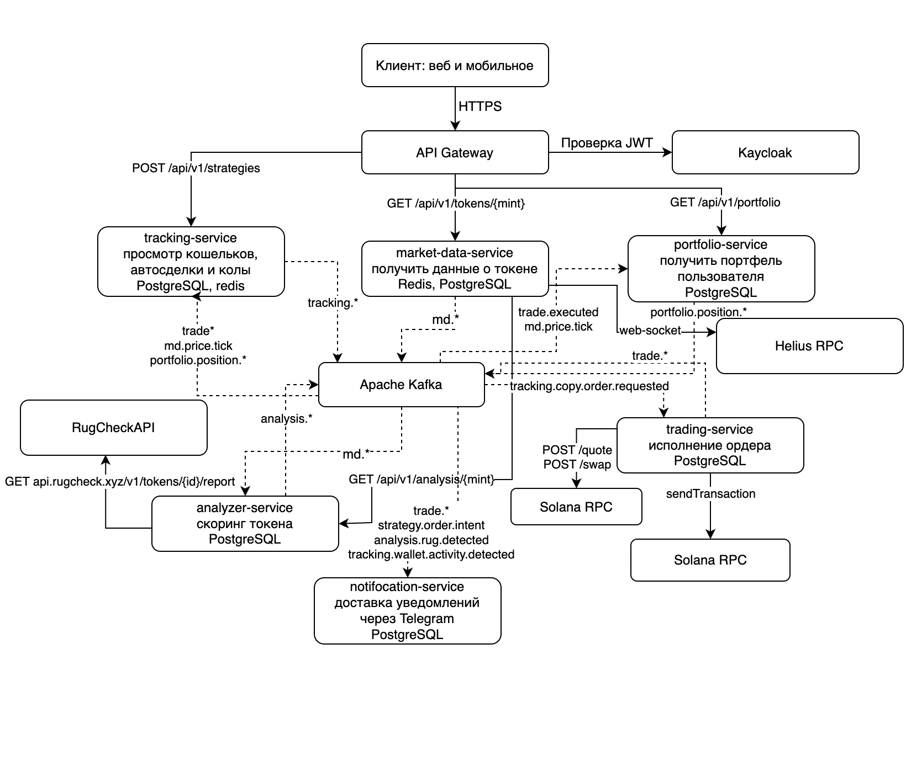
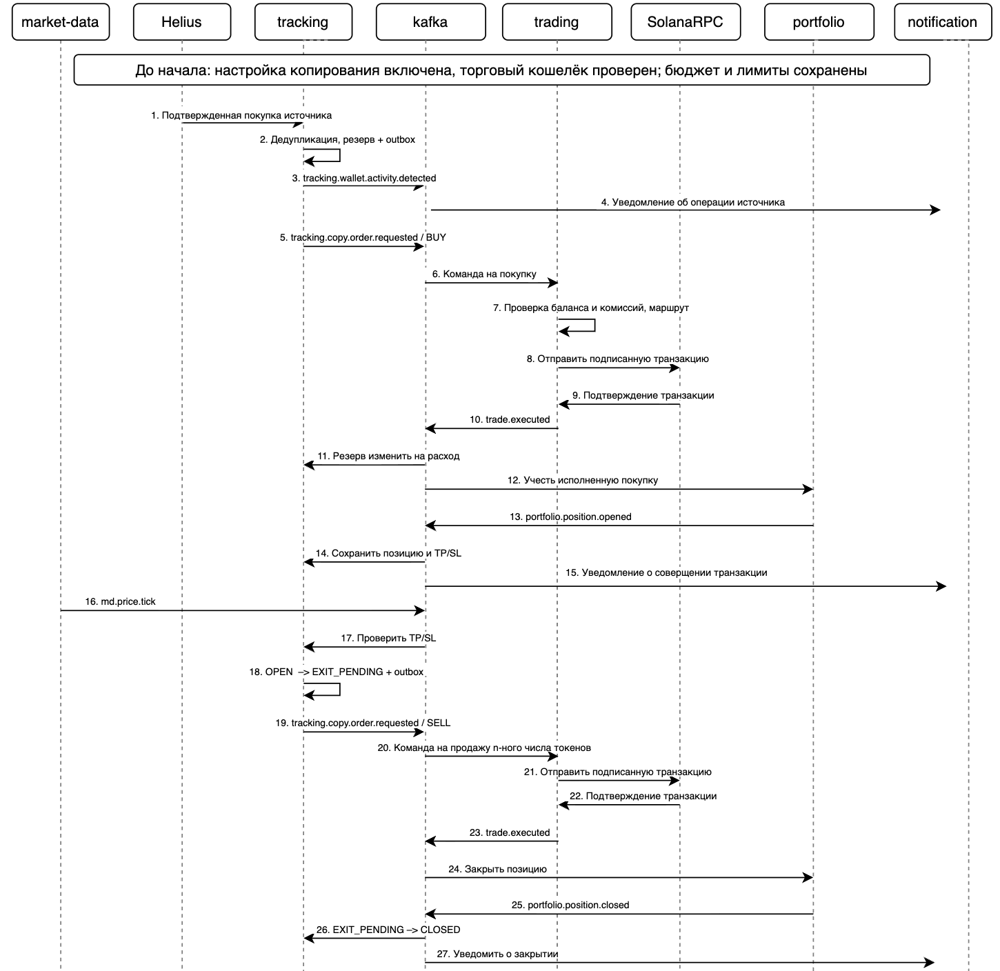
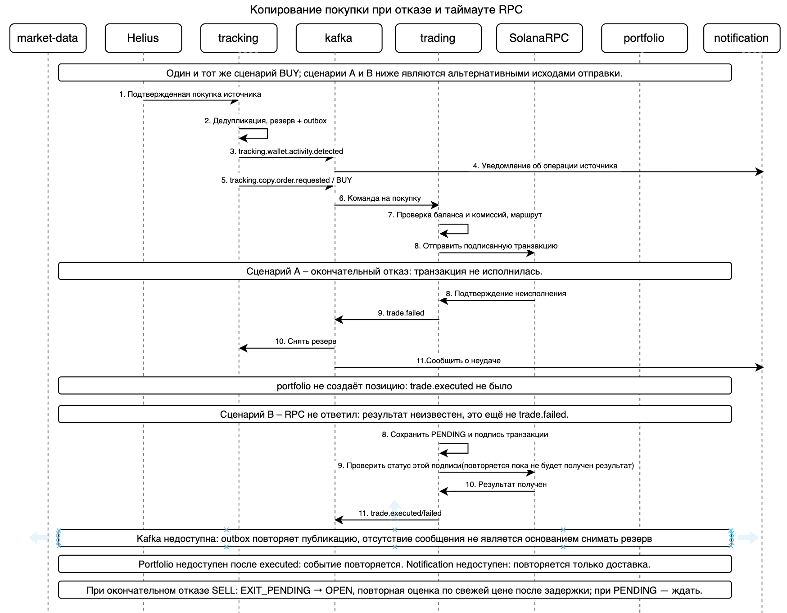

# hxku-terminal

<!-- laba3:start -->

Платформа для обнаружения, анализа и торговли мемкоинами в сети Solana. Позволяет трейдерам в реальном времени отслеживать поток новых токенов, оценивать вероятность обмана в новом токене. Так же позволяет отслеживать другие кошельки и непосредственно совершать сделки с удобными для этого параметрами.

Так же трейдеры могут отслеживать кошельки, публиковать колы и настраивать автосделки.

## Пользователи

Трейдер – настраивает трекинг кошельков, автосделки и уведомления, управляет портфелем

Администратор – мониторит здоровье системы, управляет лимитами.

## Сценарии

Как трейдер я хочу получать уведомления о новых токенах с высоким скорингом, чтобы на ранних этапах замечать перспективные проекты.

Как трейдер я хочу настраивать автопокупки по сделкам отслеживаемого кошелька, стоп-лосс и тейк-профит, чтобы не тратить время на ручную торговлю.

Как трейдер я хочу получать алерты, если позиция которую я держу имеет высокий rug-pull показатель, чтобы успеть выйти из позиции.

Как трейдер я хочу видеть свой pnl по позиции в реальном времени, чтобы понимать эффективность своих автосделок.

Как администратор я хочу мониторить потребление api лимитов внешних сервисов.

## Доменные события

### Обнаружение и анализ:

TokenDiscovered — новый токен найден в пуле

PriceUpdated — цена токена изменилась

LiquidityChanged — ликвидность пула изменилась

### Торговля:

WalletActivityDetected — обнаружена операция отслеживаемого кошелька

OrderIntentCreated — создано намерение на исполнение ордера

OrderExecuted — ордер успешно исполнен

OrderRejected — ордер отклонён (недостаточно средств, ошибка RPC)

OrderFailed — ордер провалился (таймаут, ошибка сети)

### Портфель и уведомления:

PositionOpened — открыта новая позиция

PositionClosed — позиция закрыта

PnLUpdated — обновлён PnL позиции

RugAlertTriggered — обнаружены признаки скама

NotificationSent — уведомление отправлено пользователю

## Ограниченные контексты и глоссарии

### 1. Market Data Context (Контекст рыночных данных)

Термины:

Токен — SPL-актив в сети Solana с уникальным адресом

Пул— пул ликвидности на DEX (Raydium, Orca, Meteora)

Price Tick — обновление цены токена в реальном времени

Discovery — процесс обнаружения нового токена в сети

Граница: отвечает за сбор и нормализацию данных из внешних источников, не занимается анализом рисков или торговлей.

### 2. Analysis Context (Контекст анализа)

Термины:

Rug Score — оценка вероятности скама в процентах

Rug Flag — конкретный признак скама (mint authority active, LP locked)

Топ холдеров — процент тоекнов у топ-10 холдеров

Процент снайперов— концентрация снайпер-ботов относительно всех держателей

Граница: добавляет информацию к Market Data и оценивает риски, применяя различные эвристики.

### 3. Tracking Context (Контекст трекинга)

Термины:

Отслеживаемый кошелёк — публичный кошелёк, за операциями которого наблюдает пользователь

Настройки автопокупки — сумма покупки, бюджет, проскальзывание, лимиты комиссий, стоп-лосс и тейк-профит

Операция кошелька — обнаруженная покупка, продажа или перевод токена

Кол — публикация пользователя с токеном и текстом

Граница: ведёт трекинг и ленты, принимает решения об автопокупках и выходе из позиций, не исполняет ордера напрямую.

### 4. Trading Context (Контекст торговли)

Термины:

Ордер — заявка на покупку или продажу токена

Кошелек — кошелёк пользователя с зашифрованным приватным ключом

Спиппейдж — допустимое проскальзывание цены при исполнении

Paper mode — режим симуляции без реальных транзакций

Граница: отвечает за исполнения транзакций и взаимодествие с Solana RPC.

### 5. Portfolio Context (Контекст портфеля)

Термины:

Позиция — открытая позиция с количеством токенов и средней ценой входа

Realized PnL — зафиксированная прибыль/убыток после закрытия позиции

Unrealized PnL — нереализованная прибыль/убыток по открытой позиции

Журнал — журнал всех исполненных сделок

Граница: учёт позиций и PnL, не управляет исполнением ордеров.

### 6. Notification Context (Контекст уведомлений)

Термины:

Алерт — уведомление для пользователя (новый токен, сигнал, исполнение)

Watchlist — список токенов, за которыми следит пользователь

Delivery Status — статус доставки уведомления (sent, failed, retry)

Граница: доставка сообщений через Telegram, не генерирует бизнес-события.

## Список и описание сервисов

| Поле | Что указать |
| --- | --- |
| Название | market-data-service |
| Ответственность | Непрерывный сбор данных о токенах, пулах ликвидности, ценах и объемах через внешние источники(Pump.fun,Radyum,Solana RPC, Helius RPC) |
| Владеет данными | Token, Pool, PriceTick, LiquiditySnapshot |
| Предоставляет | REST API: GET /api/v1/tokens/\{mint\}, GET /api/v1/pools; События: md.token.discovered, md.price.tick, md.liquidity.changed |
| Зависит от | DexScreener API, Solana RPC, Pump.fun |
| Нефункциональные требования | Высокая доступность, обработка большого числа запросов 24/7, задержка обнаружения нового токена &lt; 5 секунд |
| Обоснование границы | Высокая частота опроса внешних API требует отдельного масштабирования;  Адаптеры под разные источники — отдельная ответственность; Сбой в сборе данных не должен ломать анализ или торговлю |

| Поле | Что указать |
| --- | --- |
| Название | analyzer-service |
| Ответственность | добавляет информацию к market-data-service и оценивает риски, применяя различные эвристики |
| Владеет данными | TokenAnalysis, RiskScore, RugFlag, HolderDistribution |
| Предоставляет | REST API: GET /api/v1/analysis/\{mint\}; События: analysis.rug.detected |
| Зависит от | market-data-service (события), RugCheck API (синхронно для обогащения) |
| Нефункциональные требования | высокая доступность, обработка &gt; 1000 токенов в минуту, задержка для скоринга &lt; 2 секунд |
| Обоснование границы | анализ — вычислительно тяжёлая операция, требует отдельного масштабирования;  Эвристики часто меняются, что делает разработку независимой; |

| Поле | Что указать |
| --- | --- |
| Название | tracking-service |
| Ответственность | Трекинг кошельков, лента операций и колов, автопокупки, стоп-лосс и тейк-профит |
| Владеет данными | TrackedWallet, WalletActivity, Call, CopySettings, BudgetReservation, ExitSettings |
| Предоставляет | REST API: POST/GET /api/v1/tracking/wallets, POST/GET /api/v1/tracking/calls, GET/PUT /api/v1/tracking/wallets/\{id\}/copy-settings; События: tracking.wallet.activity.detected, tracking.copy.order.requested |
| Зависит от | Helius; market-data-service (REST и md.price.tick); trading-service (REST и trade.\*); portfolio-service (portfolio.position.\*) |
| Нефункциональные требования | Задержка от события до команды &lt; 1 секунды, поддержка &gt; 1000 отслеживаемых кошельков |
| Обоснование границы | трекинг кошельков, ленты и правила автосделок — отдельная доменная область; можно масштабировать независимо от исполнения |

| Поле | Что указать |
| --- | --- |
| Название | trading-service |
| Ответственность | Исполнение ордеров, взаимодействие с Jupiter и Solana RPC |
| Владеет данными | Order, Wallet(зашифрованные ключи) |
| Предоставляет | REST API: POST /api/v1/orders, GET /api/v1/orders; События: trade.executed, trade.rejected, trade.failed |
| Зависит от | tracking-service (команда tracking.copy.order.requested), Jupiter и Solana RPC |
| Нефункциональные требования | Высокая доступность, исполнение ордера не больше 3 секунд, требует шифрование ключей безопасности |
| Обоснование границы | Исполнение транзакций требует изоляции от остальных процессов; взаимодействие с Solana RPC и Jupiter требует отдельной логики  |

| Поле | Что указать |
| --- | --- |
| Название | portfolio-service |
| Ответственность | Учет позиций, PnL, журнал сделок |
| Владеет данными | Position, Trade journal, PnL |
| Предоставляет | REST API: GET /api/v1/portfolio, GET /api/v1/positions/\{id\}; События: portfolio.position.opened, portfolio.position.closed, portfolio.pnl.updated |
| Зависит от | Market-data-service (md.price.tick для отображения PnL), trading-service (trade.executed для отображания состояния позиции) |
| Нефункциональные требования | Низкая критичность, точность расчетов PnL, историчность данных о трейдах |
| Обоснование границы | Учёт сделок и рассчет PnL- отдельная ответственность; можно масштабировать независимо |

| Поле | Что указать |
| --- | --- |
| Название | notification-service |
| Ответственность | Доставка уведомлений через Telegram |
| Владеет данными | Notification, DeliveryLog, Watchlist |
| Предоставляет | REST API: POST /api/v1/notifications, GET /api/v1/notifications;  |
| Зависит от | trade.executed, trade.rejected, trade.failed, analysis.rug.detected, tracking.wallet.activity.detected |
| Нефункциональные требования | Низкая критичность, логика ретраев, рейт лимит для Telegram API |
| Обоснование границы | Сбой в доставке уведомлений не должен влиять на остальной флоу; Можно добавить новые каналы (Discord) без изменения других сервисов; Отдельное масштабирование под пиковые нагрузки |

## Отвергнутые альтернативы

### Объединение market-data-service и analyzer-service

Рассматривалось объединение market-data-service и analyzer-service, но из за нагрузки разного вида этого не стоит делать. Сбор данных ограничен вызовами внешних API, а анализ требует отдельных вычислительных ресурсов, что требует независимого масштабирования. К тому же эвристики скоринга могут часто меняться, в отличие от сбора данных который подразумевает просто вызов внешних API, изменение правил анализа будет требовать передеплой всего сервиса, а смысла останавливать сбор данных нежелателен.К тому же, при сбое анализатора события из market-data-service могут просто копиться в Kafka и потом уже обработаться анализатором.

### Объединение trading-service и portfolio-service

Объединение сервиса исполнения и учета может показаться органичным и выгодным, но лучше вынести trading сервис в отдельный сервис из-за безопасности, т.к. он работает с ключами безопасности. Так же из за того что сервис исполнения транзакций write-heavy, а сервис портфолио read-heavy, занимается много соединений в бд: если Solana RPC будет зависать, сервис транзакций будет просто занимать соединение в бд. К тому же trading-service имеет высокие требования к консистенции, потому что каждая транзакция это деньги, лучше разделить сервисы и масштабировать сервис портфолио горизонтально за счет реплик для чтения бд и вертикально масштабировать сервис трейдов для оптимизации транзакций.

| Компонент | Кто использует | Обоснование |
| --- | --- | --- |
| PostgreSQL | market-data, trading, analyzer, portfolio, notification, tracking | транзакции, оконные функции и CTE, поддержка JSONB, строгая типизация |
| Redis | market-data, trading | market-data: кеш последних цен, trading: распределенные блокировки для предотвращения двойного исполнения ордеров  |
| Apache Kafka | Все сервисы | Большой поток событий, возможность повторного чтения, несколько независимых потребителей |
| Spring Cloud Gateway | Клиент  | Единая точка входа, маршрутизация запросов к сервисам,JWT-auth, rate limiting. |
| Keycloak | Spring Cloud Gateway | OAuth 2.0 / OpenID Connect для аутентификации пользователей. Это надежнее нежели самостоятельная реализация аутентификации. |
| Resilience4j | market-data, trading | Circuit breaker для внешних API, ретраи, рейт лимиты. |
| Micrometer + Prometheus + Grafana | Все сервисы | Метрики: latency, throughput, error rate. Мониторинг потребления API-лимитов. |
| Vault | trading-service | Хранение приватных ключей кошельков.  Ротация ключей без перезапуска сервиса. |

| Инициатор-полчатель | Тип | Эндпоинт или событие | Назначение |
| --- | --- | --- | --- |
| client -&gt; market-data | sync | GET /api/v1/tokens/\{mint\} | Получить данные о токене |
| client -&gt; tracking | sync | POST /api/v1/tracking/wallets | Добавить кошелёк в отслеживание |
| client -&gt; portfolio | sync | GET /api/v1/portfolio | Получить портфель пользователя |
| market-data -&gt; Helius RPC | sync | wss://mainnet.helius-rpc.com, JSON-RPC: accountSubscribe / logsSubscribe | Установить соединение и подписаться на изменения пулов и логи DEX программ |
| Helius RPC -&gt; market-data | async | accountNotification / logsNotification | Получение изменения пулов и события программ для показа цены в реальном времени и обнаружения новых пулов  |
| market-data -&gt; analyzer | async | md.token.discovered | Уведомить о новом токене |
| analyzer -&gt; ReuCheckAPI | sync | GET /api.rugcheck.xyz/v1/tokens/\{id\}/report | Получить вероятность скама токена |
| market-data -&gt; tracking | async | md.price.tick | Передать цену для стоп-лосса и тейк-профита |
| tracking -&gt; trading | async | tracking.copy.order.requested | Запрос на автопокупку или автоматический выход из позиции |
| trading -&gt; Jupiter | sync | POST /quote, POST /swap | Получить маршрут и транзакцию для свопa |
| trading -&gt; Solana RPC | sync | sendTransaction | Отправить подписанную транзакцию |
| trading -&gt; portfolio | async | trade.executed | Уведомить об успешном исполнении |
| trading -&gt; notification | async | trade.executed | Отправить уведомление пользователю |
| market-data -&gt; portfolio | async | md.price.tick | Обновить PnL позиций |
| analyzer -&gt; notification | async | analysis.rug.detected | Алерт о признаках скама |

<!-- laba3:end -->

## Схемы

### Архитектура сервисов

[Исходная схема drawio](docs/architecture.drawio) · [Открыть PNG](docs/architecture.png)

### Успешный сценарий автосделки

[Исходная схема drawio](docs/sequence-successful.drawio) · [Открыть PNG](docs/sequence-successful.png)

### Неуспешный сценарий автосделки

[Исходная схема drawio](docs/sequence-unsuccessful.drawio) · [Открыть PNG](docs/sequence-unsuccessful.png)

## События Kafka

| Топик | Издатель | Подписчики | Схема сообщения |
| --- | --- | --- | --- |
| `md.price.tick` | `market-data-service` | `tracking-service`, `portfolio-service` | [PriceTick](api/market-data.asyncapi.yaml#L139) |
| `md.token.discovered` | `market-data-service` | `analyzer-service` | [TokenDiscovered](api/market-data.asyncapi.yaml#L180) |
| `md.liquidity.changed` | `market-data-service` | `analyzer-service` | [LiquidityChanged](api/market-data.asyncapi.yaml#L219) |
| `analysis.rug.detected` | `analyzer-service` | `notification-service` | [RugDetected](api/analyzer.asyncapi.yaml#L237) |
| `trade.executed` | `trading-service` | `tracking-service`, `portfolio-service`, `notification-service` | [TradeExecuted](api/trading.asyncapi.yaml#L500) |
| `trade.failed` | `trading-service` | `tracking-service`, `portfolio-service`, `notification-service` | [TradeFailed](api/trading.asyncapi.yaml#L714) |
| `portfolio.position.opened` | `portfolio-service` | `tracking-service` | [PositionOpened](api/portfolio.asyncapi.yaml#L690) |
| `portfolio.position.updated` | `portfolio-service` | `tracking-service` | [PositionUpdated](api/portfolio.asyncapi.yaml#L780) |
| `portfolio.position.closed` | `portfolio-service` | `tracking-service` | [PositionClosed](api/portfolio.asyncapi.yaml#L870) |
| `tracking.wallet.activity.detected` | `tracking-service` | `notification-service` | [WalletActivityDetected](api/tracking.asyncapi.yaml#L1169) |
| `tracking.copy.order.requested` | `tracking-service` | `trading-service` | [CopyOrderRequested](api/tracking.asyncapi.yaml#L1253) |
| `trade.rejected` | `trading-service` | `tracking-service`, `notification-service` | [TradeRejected](api/trading.asyncapi.yaml#L644) |
| `notification.sent` | `notification-service` | — | [NotificationSent](api/notification.asyncapi.yaml#L854) |

## Контракты API

| Сервис | OpenAPI — HTTP | AsyncAPI — Kafka |
| --- | --- | --- |
| `market-data-service` | [market-data.openapi.yaml](api/market-data.openapi.yaml) | [market-data.asyncapi.yaml](api/market-data.asyncapi.yaml) |
| `analyzer-service` | [analyzer.openapi.yaml](api/analyzer.openapi.yaml) | [analyzer.asyncapi.yaml](api/analyzer.asyncapi.yaml) |
| `tracking-service` | [tracking.openapi.yaml](api/tracking.openapi.yaml) | [tracking.asyncapi.yaml](api/tracking.asyncapi.yaml) |
| `trading-service` | [trading.openapi.yaml](api/trading.openapi.yaml) | [trading.asyncapi.yaml](api/trading.asyncapi.yaml) |
| `portfolio-service` | [portfolio.openapi.yaml](api/portfolio.openapi.yaml) | [portfolio.asyncapi.yaml](api/portfolio.asyncapi.yaml) |
| `notification-service` | [notification.openapi.yaml](api/notification.openapi.yaml) | [notification.asyncapi.yaml](api/notification.asyncapi.yaml) |
